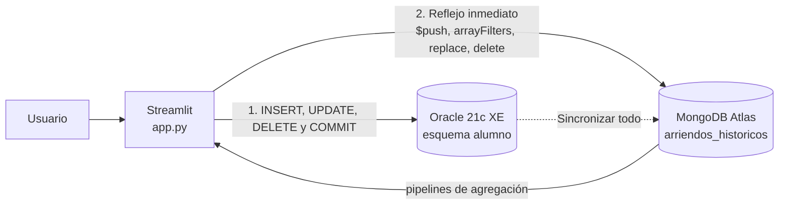

<p align="center">
  
</p>

<h1 align="center">Truck Rental</h1>

<p align="center">
  De Oracle a MongoDB: una interfaz web que registra arriendos y multas en Oracle<br>
  y los refleja al instante en MongoDB Atlas, con un dashboard calculado en Mongo.
</p>

<p align="center">
  
  
  
  
</p>

---

## Contenido

- [Descripción](#descripción)
- [Qué incluye](#qué-incluye)
- [Arquitectura](#arquitectura)
- [Requisitos](#requisitos)
- [Instalación](#instalación)
- [Preparar Oracle](#preparar-oracle)
- [Preparar MongoDB Atlas](#preparar-mongodb-atlas)
- [Ejecutar la app](#ejecutar-la-app)
- [Inicio de sesión](#inicio-de-sesión)
- [Páginas de la app](#páginas-de-la-app)
- [Cómo funciona la sincronización](#cómo-funciona-la-sincronización)
- [Documento de MongoDB](#documento-de-mongodb)
- [Configuración local y tema](#configuración-local-y-tema)
- [Estructura del proyecto](#estructura-del-proyecto)
- [Seguridad](#seguridad)
- [Solución de problemas](#solución-de-problemas)
- [Equipo](#equipo)

## Descripción

Truck Rental es el proyecto del taller de bases de datos (BDY1103, Duoc UC) sobre una empresa de arriendo de camiones.
Parte del modelo relacional en Oracle y lo lleva a un modelo de documentos en MongoDB.

El profesor pidió dos cosas, y la app resuelve ambas con una sola página web:

1. Una interfaz "según Oracle", cuyos datos se reflejan en MongoDB.
2. Una interfaz de MongoDB más amigable que Atlas o la consola.

Oracle es la **fuente de verdad**: ahí se guardan los arriendos, las multas y el trigger que valida las fechas.
MongoDB guarda cada arriendo como un documento autosuficiente y calcula el dashboard con pipelines de agregación, sin JOIN.

## Qué incluye

- Inicio de sesión que pide lo que necesitan las dos bases (usuario y contraseña de Oracle, usuario y contraseña de MongoDB Atlas) y prueba ambas antes de entrar.
- Dashboard ejecutivo con cuatro indicadores y cuatro gráficos, todos calculados en MongoDB.
- Ficha de cliente: se busca por nombre o RUT y muestra su estado, su saldo por cobrar, sus arriendos y sus multas.
- Registro de arriendos y de multas en Oracle, con reflejo inmediato en MongoDB.
- Cambio de estado de multas (pendiente, pagada, condonada) y condonación por cliente.
- Consulta y eliminación de arriendos.
- Página de sincronización que compara las dos bases y, si hace falta, vuelve a copiar todo desde Oracle.
- Mensajes de error en español para los fallos más comunes de Oracle y MongoDB.
- Iconos propios y diseño oscuro con tarjetas de colores, sin emojis.

## Arquitectura



| Capa | Tecnología | Para qué se usa |
| --- | --- | --- |
| Transaccional | Oracle 21c XE (`oracledb`, modo thin) | Arriendos, multas, trigger de validación y secuencias |
| Analítica | MongoDB Atlas (`pymongo`) | Un documento por arriendo, dashboard y fichas de cliente |
| Interfaz | Streamlit, Plotly | Páginas, formularios y gráficos |

## Requisitos

- Oracle Database 21c XE encendido, con SQL Developer para ejecutar los scripts.
- Python 3.10 o superior (probado con 3.14 y Streamlit 1.67).
- Un clúster de MongoDB Atlas (el plan gratuito M0 alcanza) con un usuario de base de datos y tu IP autorizada en Network Access.

## Instalación

```bash
git clone https://github.com/<usuario>/truck-rental.git
cd truck-rental

# opcional pero recomendado: entorno virtual
python -m venv .venv
.venv\Scripts\activate          # en Linux o macOS: source .venv/bin/activate

python -m pip install -r requirements.txt
```

`oracledb` trabaja en modo thin, por lo que no hace falta instalar Oracle Client.

## Preparar Oracle

Los scripts están en la carpeta [`sql/`](sql/). Se ejecutan una sola vez, en este orden:

| Orden | Archivo | Conectado como | Qué hace |
| --- | --- | --- | --- |
| 1 | `sql/01_crear_usuario.sql` | `SYS` en el servicio `XEPDB1` | Crea el usuario `alumno` (solo si no existe) |
| 2 | Script de la clase `1_1_6_crea_pobla_tablas_bd_TRUCK_RENTAL.sql` | `alumno` | Crea las tablas del taller y carga 98 arriendos |
| 3 | `sql/02_multa_y_trigger.sql` | `alumno` | Crea `SEQ_MULTA`, la tabla `MULTA`, el trigger `trg_valida_fecha_devolucion` y cinco multas de ejemplo |

Antes del paso 3, verifica que la hoja de SQL Developer esté conectada al usuario correcto:

```sql
SELECT USER FROM dual;   -- debe responder ALUMNO
```

Resultado esperado después del paso 3: 5 multas, de las cuales 3 están pendientes y suman 110.000.

## Preparar MongoDB Atlas

1. Crea un clúster gratuito (M0).
2. En **Database Access**, crea un usuario de base de datos con permisos de lectura y escritura. Este usuario es el que pide la app, no tu cuenta de Atlas.
3. En **Network Access**, agrega tu IP actual. Si cambias de red o de computador, agrégala de nuevo.
4. En **Connect > Drivers**, copia el servidor (la parte `cluster0.xxxxx.mongodb.net` de la cadena de conexión).

La base `truck_rental_db` y la colección `arriendos_historicos` se crean solas en la primera sincronización.

## Ejecutar la app

Desde la carpeta del proyecto:

```bash
python -m streamlit run app.py
```

Se abre una pestaña en `http://localhost:8501`. La primera vez, entra a **Sincronización** y presiona **Sincronizar todo** para copiar los datos de Oracle a MongoDB. Si el puerto está ocupado, agrega `--server.port 8502`.

## Inicio de sesión

| Sección | Campo | Valor habitual |
| --- | --- | --- |
| Oracle | Usuario Oracle | `alumno` |
| Oracle | Contraseña Oracle | la de tu usuario |
| MongoDB Atlas | Usuario MongoDB | usuario de base de datos de Atlas |
| MongoDB Atlas | Contraseña MongoDB | la de ese usuario |
| Ajustes de conexión | Host de Oracle | `localhost` |
| Ajustes de conexión | Puerto de Oracle | `1521` |
| Ajustes de conexión | Servicio de Oracle | `XEPDB1` |
| Ajustes de conexión | Servidor de MongoDB | `cluster0.xxxxx.mongodb.net` |
| Ajustes de conexión | Base de datos de MongoDB | `truck_rental_db` |

La app prueba las dos conexiones antes de entrar y avisa cuál falló. Las contraseñas viven solo en la sesión del navegador: no se escriben en ningún archivo.

## Páginas de la app

| Página | Qué hace |
| --- | --- |
| Dashboard | Indicadores y gráficos calculados en MongoDB, con la consulta de cada widget a la vista |
| Clientes | Búsqueda por nombre o RUT y ficha con estado, saldo por cobrar, arriendos y multas |
| Nuevo arriendo | Registra un arriendo en Oracle (el trigger valida las fechas) y lo refleja en MongoDB |
| Multas | Registrar multa, cambiar su estado y condonar las pendientes de un cliente |
| Arriendos | Consulta con filtros, documento completo de cada arriendo y eliminación |
| Sincronización | Compara Oracle y MongoDB y permite volver a copiar todo desde Oracle |

## Cómo funciona la sincronización

- **Automática al actuar.** Cada acción de la app (registrar un arriendo o una multa, cambiar un estado, eliminar) se guarda primero en Oracle con `COMMIT` y enseguida en MongoDB. Si MongoDB no responde, el dato queda a salvo en Oracle y la app avisa que hay que sincronizar.
- **Manual para reparar.** Si alguien modifica Oracle por fuera de la app (por ejemplo, desde SQL Developer), la app no se entera. El botón **Sincronizar todo** copia todo desde Oracle con un `ReplaceOne` en lote (upsert) y elimina de MongoDB los documentos que ya no existen en Oracle.

Operadores de MongoDB que se usan para reflejar los cambios:

| Acción en la app | Operación en MongoDB |
| --- | --- |
| Registrar multa | `update_one` con `$push` sobre el arreglo `multas` |
| Cambiar estado de una multa | `update_one` con `$set` y `arrayFilters` |
| Condonar por cliente | `update_many` con `$set` y `arrayFilters` |
| Nuevo arriendo y sincronización | `replace_one` / `bulk_write` con `upsert` |
| Eliminar arriendo | `delete_one` |

## Documento de MongoDB

Cada arriendo se guarda como un documento autosuficiente (con el camión, el cliente y las multas incluidos):

```json
{
  "_id": "ARR-2025-0001",
  "id_oracle": 1,
  "anno_proceso": 2025,
  "camion": { "patente": "AA1001", "marca": "Toyota", "tipo_camion": "Trailer" },
  "cliente": { "rut": "10639521", "nombre": "Miguel Angel Uval", "tipo_cliente": "Socio" },
  "fechas": { "inicio": "2025-03-03T00:00:00", "devolucion": "2025-03-07T00:00:00", "dias_solicitados": 1 },
  "finanzas": {
    "valor_arriendo_dia": 23000,
    "total_arriendo": 23000,
    "garantia_aplicada": "POR DEFECTO",
    "monto_garantia": 100000
  },
  "multas": [
    { "id_multa": 1, "tipo": "RETRASO", "monto": 30000, "estado": "PENDIENTE", "detalles": { "dias_retraso": 3 } },
    { "id_multa": 2, "tipo": "DAÑO", "monto": 50000, "estado": "PAGADA", "detalles": { "descripcion": "Rayón en puerta lateral" } }
  ],
  "origen": "oracle",
  "sincronizado": "2026-11-24T13:00:00Z"
}
```

La garantía `POR DEFECTO` se aplica cuando el camión no tiene garantía propia en Oracle (`NVL(garantia, 100000)`).

## Configuración local y tema

- `config_local.json` (opcional): deja escritos en el formulario tus datos que no son secretos (usuario de Atlas, servidor, servicio de Oracle). Copia `config_local.example.json`, cámbiale el nombre a `config_local.json` y edítalo. Está en `.gitignore`, así que no se sube al repositorio. Nunca guarda contraseñas.
- `.streamlit/config.toml`: fija el tema oscuro con los colores de la app. Si falta, la app funciona igual con el tema del sistema.

## Estructura del proyecto

```text
truck-rental/
├── app.py                        # toda la aplicación (conexiones, sincronización, páginas y estilos)
├── requirements.txt              # dependencias de Python
├── config_local.example.json     # valores de ejemplo para el formulario de conexión
├── .streamlit/
│   └── config.toml               # tema oscuro
├── assets/
│   └── logo.svg                  # logo de Truck Rental
├── sql/
│   ├── 01_crear_usuario.sql      # usuario alumno
│   └── 02_multa_y_trigger.sql    # tabla MULTA, secuencia, trigger y datos de ejemplo
└── README.md
```

## Seguridad

- Las contraseñas de Oracle y de MongoDB se piden en cada inicio de sesión y no se almacenan en disco.
- `config_local.json` solo debe contener datos no secretos y está excluido de Git.
- Todas las consultas a Oracle usan variables de enlace (`:p_id`, `:p_run`, etc.), no se arman con texto concatenado.
- Los textos que se muestran en tablas HTML se escapan antes de dibujarse.
- En Atlas, autoriza solo las IP que realmente uses.

## Solución de problemas

| Mensaje | Qué hacer |
| --- | --- |
| Usuario o contraseña de Oracle incorrectos (`ORA-01017`) | Prueba las mismas credenciales en SQL Developer |
| No se pudo conectar con Oracle (`ORA-12541`, `DPY-6005`) | Enciende `OracleServiceXE` y el listener; revisa host, puerto y servicio `XEPDB1` |
| Falta una tabla en Oracle (`ORA-00942`) | Ejecuta `SELECT USER FROM dual;` y corre `sql/02_multa_y_trigger.sql` desde la conexión `alumno` |
| El trigger de Oracle rechazó el registro (`ORA-20001`) | La fecha de devolución es anterior al inicio; corrígela |
| Usuario o contraseña de MongoDB incorrectos | Usa el usuario de base de datos de Atlas, no tu cuenta |
| MongoDB Atlas no respondió | Agrega tu IP actual en Network Access y revisa tu internet |
| El Dashboard dice que MongoDB está vacío | Haz la primera sincronización en la página Sincronización |
| La app pide iniciar sesión otra vez | Recargar el navegador (F5) cierra la sesión; es lo esperado |

El manual de uso paso a paso, con pruebas de verificación y un guion para la demo, está en el documento «Manual de Uso: Truck Rental (Oracle + MongoDB)» del equipo.

## Equipo

Proyecto del taller de base de datos (BDY1103), Duoc UC.

- Dominga Ruiz
- Jenifer Galiz
- Daniel Gonzalez

<!--
Capturas de pantalla (agrégalas cuando tengas la app corriendo con tus datos y quita este comentario):


-->
